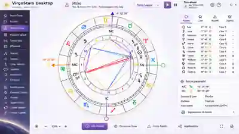

# VirgoStars Desktop — UI Design Guidelines

**Status:** accepted visual direction (light-theme concept); implementation specifications and dark-theme values remain subject to testing.  
**Updated:** 2026-11-10  
**Applies to:** the VirgoStars Desktop application shell and all native-like desktop views.

## 1. Product identity and visual reference

The product name is **VirgoStars Desktop**, consistently used in title bars, About, settings, installers, documentation, screenshots prepared for release and credits. Do not introduce alternative product or module branding into the user interface. The application belongs to the VirgoStars ecosystem.

### Approved light-mode visual direction

The image above is a **visual design reference**, not a screenshot of an implemented application, and **not** a verified astronomical chart. All birth data, coordinates, planetary positions, colors, aspect lines, wording and button behaviors in the concept are illustrative and must not be copied as computation results. Any mockup-specific wording is subordinate to the VirgoStars identity rules in this document.

**Preserve from the reference:** restrained pale canvas, dark purple navigation, strong large central chart, slim top bar, contextual information on the right, compact action bar, clear iconography and modest purple accent.

**Improve on the reference:** eliminate decorative space imagery in normal work mode; reduce permanent chrome; prevent chart clipping and label collisions; make side panels collapsible; resolve contrast and glyph legibility; ensure chart outputs come from real data only.

## 2. Non-negotiable principles

1. **Chart first:** the astrological chart is the single strongest visual element. Always keep it prominently centered in the chart workspace and maximize its diameter subject to safe margins and readable labels.
2. **Modern and restrained:** flat or softly layered surfaces; subtle shadows and borders; no glowing buttons, skeuomorphism, excessive gradients, ornamental zodiac backdrops or distracting animations.
3. **Professional clarity:** critical values are text, not conveyed by color or icons alone. Dense information is available on demand rather than always displayed.
4. **Consistent twins:** light and dark themes have identical layout, features, navigation hierarchy and semantic colors; only surface/text tokens and suitable chart contrast differ.
5. **Progressive disclosure:** sidebars and inspectors can collapse. Deep expert controls live in context panels, drawers and dedicated views.
6. **Accuracy over decoration:** chart geometry, house cusps, coordinates, zodiac, retrograde markers, orbs and aspect mapping must be driven by validated calculations, never hard-coded into product UI.
7. **Keyboard accessible and localized:** usable without a mouse, with appropriate focus order, predictable shortcuts, IT/EN strings, correct locale formatting and descriptive tooltips.

## 3. Desktop shell, chart centering, sizing

### Permanent structural regions

| Region | Contents | Sizing guideline | Behavior |
| --- | --- | --- | --- |
| Top bar | App identity, subject selector, mode, current moment/play-pause, settings | 56–64 px | Single row where possible; avoid long title strings stealing chart width |
| Left navigation | Chart modes, time, archives, analysis, advanced tools | 196–224 px expanded, 52–64 px collapsed | One click to collapse, preserve selection and tooltips |
| **Central workspace** | **Chart and chart-local controls** | **flex: 1; min-width: 0; min-height: 0** | Chart stays centered and maximized within usable central viewport |
| Right inspector | Tabs: Planets, Houses, Aspects, Parameters; selected object details | 296–344 px expanded | Collapsible; optional overlay if window is narrow; no forced chart shrink to illegibility |
| Bottom contextual toolbar | Zoom, chart corrections, aspect focus, report/export, applicable playback | 52–64 px | Context-based actions; no giant full-width buttons or duplicate navigation |

The chart's **outer diameter includes glyphs, exterior angular markers and their safe padding**. Determine diameter from both remaining width and remaining height; never size solely against window width. As panels expand/collapse or the window resizes, recompute diameter smoothly and maintain chart center. Preferred chart canvas is square with a safe exterior padding of 24–40 px, adjusted for labels.

The chart must be completely visible at normal zoom (no edge clipping). Zoom and pan are optional user-controlled modes; a one-click **Fit chart** action returns to the full chart. Use ResizeObserver and a single source of truth for viewport state. Do not move the chart center when clicking a planet or changing inspector tabs.

**Initial design QA viewports:** 1920×1080, 1600×900, 1440×900, 1366×768, and 1280×720; test 125%/150% OS scaling. At narrow sizes collapse side panels before reducing chart readability; keep all actions reachable through a menu or drawer. This is a desktop app; do not promise mobile support in this repository.

## 4. Color system — initial tokens, tune by measured contrast

These are proposed starting tokens, not sampled/approved brand values. Define semantic CSS variables and maintain two token sets rather than styling per screen. No hard-coded color literals in components.

| Token | Light | Dark | Role |
| --- | --- | --- | --- |
| `--vs-bg` | `#F7F8FC` | `#0F1220` | Application backdrop |
| `--vs-surface` | `#FFFFFF` | `#191D2F` | Panels and cards |
| `--vs-surface-muted` | `#F0EDF7` | `#252840` | Secondary fill |
| `--vs-text` | `#24243B` | `#F2F1FA` | Primary text |
| `--vs-text-secondary` | `#61627A` | `#B7B8CC` | Secondary text |
| `--vs-border` | `#DADCE8` | `#3A3D55` | Subtle dividers |
| `--vs-accent` | `#7146B5` | `#B392F2` | Selection and primary actions |
| `--vs-accent-contrast` | `#FFFFFF` | `#17122A` | Text on accent |
| `--vs-sidebar` | `#302A47` | `#19172C` | Navigation background |
| `--vs-focus` | `#5830AD` | `#C7A9FF` | Visible focus outline |

The navigation sidebar can remain dark purple in both themes, while surfaces invert in dark mode. Gold is reserved for limited semantic or decorative chart highlights, **not** as an additional competing primary interface color.

Astrological chart sign hues are a **separate semantic palette** from app UI tokens. Planet symbols, sign glyphs, aspect types, axis markers and their colors must be configurable in the chart renderer and remain consistent across themes. Complement colors with line styles, shapes and table labels to support color-vision differences.

## 5. Typography, icons and spacing

- Prefer **Inter** or a comparably legible open-licensed UI sans serif; fall back to platform system fonts. Do not ship arbitrary font binaries without a license review.
- Body: 14–15 px, line-height 1.4–1.5. Dense numerical tables: 13–14 px with tabular figures. Section headers: 16–18 px. Primary screen title: 20–24 px, sparingly used.
- Use a consistent 4 px spacing scale (8/12/16/24/32 for common gaps). Target 8 px corner radii for components, 12 px for panels; avoid excessive pills on every control.
- Icons: one coherent line-icon family (approximately 18–20 px); pair unlabeled icons with accessible names and explanatory tooltips.
- Zodiac/planetary symbols require a tested symbol-font or approved asset source. Keep UI icons and astrological glyphs visually distinct.
- Hover, active, selected, disabled, loading and focus states must each be distinguishable; avoid relying on hue alone.

## 6. Chart rendering and interactivity

### Chart layers

Render independent layers for zodiac signs, house bands and cusps, planets/points, axes, exterior degree markers, aspect lines, selection/focus highlights, and overlays (transits, synastry, directions, returns). Each layer is individually switchable, but the base chart remains visible.

- Maintain strict polar geometry and stable orientation while chart data or theme changes.
- Prevent glyph overlap with deterministic collision avoidance, leader lines and radial staggering. Never silently omit a body; surface overflow through selectable labels or a planet table.
- Selected planet/point: emphasize its glyph and connected aspects, slightly de-emphasize unrelated lines, and show precise values in the contextual inspector.
- Selected aspect: show bodies, type, orb, applying/separating status **only when available from domain data**.
- Provide zoom +/- and Fit chart; tooltips on hover and click, keyboard-selectable planet/aspect lists and a clear-screen-reader table equivalent.
- Keep aspect color mappings consistent; do not use very fine lines as the sole signal. Allow per-type filters and user-controlled orb thresholds.
- Charts should render crisply with high-DPI support and be exportable as a high-resolution raster; vector export may follow after architectural validation.
- Animations in live/transit mode must be unobtrusive and respect reduced-motion settings.
- If birth time is unknown, do **not** invent or imply reliable Ascendant, Midheaven or houses; label unavailable/conditional data.

### Computation boundaries

The desktop shell consumes structured domain outputs from `VirgoStars-Ephemeris` and `astrological-functions`, rendering through `astrological-charts` and approved `astrological-assets`. No Swiss Ephemeris code or copied third-party assets. The UI must not duplicate astronomical algorithms or treat the mockup's chart values as test fixtures.

## 7. Core screens and interaction contracts

- **Natal chart:** chart centered; subject details accessible from top bar; right inspector defaults to planet list.
- **Transits:** natal inner/transit outer distinction; date and timezone visible; time-step controls/playback in a compact, non-obstructive strip. Loading and paused states explicit.
- **Real-time:** current local time, timezone and rate/last-refresh indicator. Pause behavior must be unambiguous.
- **Archive:** searchable, filterable list or drawer; opening the archive must not destroy the current chart state.
- **Chart correction:** non-destructive form in a side drawer or separate mode; distinguish Save/Cancel/Reset and preview unsaved changes.
- **Synastry, directions, returns:** share the same central chart conventions, panel system and export flow; introduce tailored controls only as those features become available.
- **Advanced astrology:** antiscions, fixed stars, lots, decans, terms etc. belong under appropriately labeled specialist tools; availability must reflect actual implemented calculations.

## 8. Accessibility and data protection

- Aim for WCAG 2.2 AA for interface controls and text (4.5:1 normal text, 3:1 large text and essential UI indicators); validate both themes with actual contrast tests.
- Full keyboard tab order; Enter/Space activation; Escape closes drawers and popovers; visible 2 px focus ring; touch/click targets preferably >= 36×36 px in a dense desktop UI.
- Respect OS text scaling, high-DPI and reduced motion; no forced low-contrast gray text on pale backgrounds.
- Treat subjects' birth date, time and place as sensitive personal data. Do not include real user data in logs, demo screenshots, fixture exports or telemetry. All published examples must use synthetic or explicitly approved data.
- All displayed dates, location details, coordinate signs, degree/minute/second fields and DST/timezone formatting must be validated and localized; sexagesimal seconds must be < 60.

## 9. Design QA / acceptance checks

A design change is acceptable only if it:
- Keeps the chart centered, fully visible and **as large as reasonably possible** in every supported desktop viewport.
- Works with both light and dark without changing the information architecture.
- Does not introduce new competing branding or unapproved artwork.
- Keeps keyboard navigation, focus state and color contrast functional.
- Prevents overlapping glyphs or provides a deliberate way to inspect them.
- Does not display fictitious computed data outside clearly labeled design mockups.
- Supports collapsible navigation and inspector panels without losing context.
- Provides states for loading, empty/error, save/cancel, paused/live and offline as applicable.
- Has before/after screenshots at two target resolutions and a dark-mode comparison when implementation begins.

## 10. Implementation sequence (proposal)

1. Create semantic light/dark token layers and base shell layout, with feature toggles for unfinished functionality.
2. Implement responsive central chart container, collapse controls and Fit chart; verify visual snapshots at target sizes.
3. Integrate an actual renderer behind a typed data contract (no mocked chart values on released screens).
4. Build the shared inspector and selection/highlight behavior.
5. Add time/transit tools and editing flows incrementally, with tests and non-production test data.

This document sets **design constraints**, not evidence that any feature above already exists or is production-ready.
